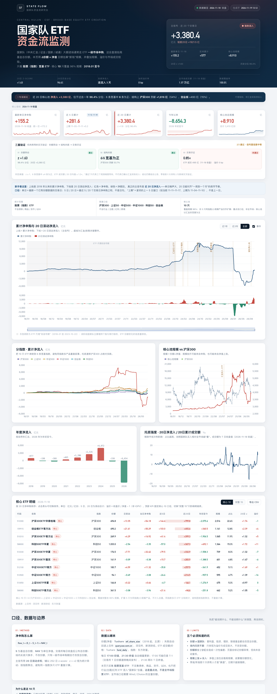

# 国家队 ETF 资金流监测 · State Flow

一个每天自动更新的单页看板：用 **ETF 总份额变动 × 净值**，估算中央汇金 / 证金等“国家队”借道宽基 ETF 的净申购，并给出历史曲线、分指数结构、规模、溢价与托底强度。

> 打开 `index.html` 即可查看（纯静态，不需要服务器、不需要联网）。



## 1. 只看哪些 ETF？

国家队托底几乎只走 **股票（指数）宽基 ETF**。因此本页明确排除：

- ❌ 债券 ETF、商品 ETF、货币 ETF、QDII / 跨境 ETF
- ❌ 行业、主题、红利、金融等窄基 ETF
- ❌ 同一指数下规模过小、流动性不足的“同质产品”

核心口径是 **10 只**：

| 宽基 | 代码 |
|---|---|
| 沪深300 | 510300、510310、510330、159919 |
| 上证50 | 510050 |
| 中证500 | 510500 |
| 中证1000 | 512100 |
| 科创50 | 588000、588080 |
| 创业板 | 159915 |

这 10 只覆盖 15 只完整池约 **96.4%** 的规模。另 5 只（512500、560010、159845、159922、159629）作为“扩展池”，只做完整性参考，不计入总量。

选择规则很简单、可复现：**在 15 只股票宽基 ETF 中按最近一期规模排序，取最小的 N，使 6 条宽基指数全部有代表且累计规模覆盖 ≥95%**——结果是 N=10、覆盖 96.4%。每季度复核一次，避免按日调整。它不是官方名单，也不是统计最优解，而是一个透明、稳定的信号池。

**为什么不把 100 多只股票 ETF 全加起来：**

1. 同一指数有多只 ETF，全部相加会重复计算同一笔指数暴露；
2. 小规模 ETF 的份额变动更容易被套利盘、做市商和单笔机构申赎放大，噪音大；
3. 国家队披露与市场共识集中在上述宽基，行业/主题 ETF 即使有资金流入，也不能直接解释为“国家队托底”。

看板里仍保留“完整 15”切换，方便核对扩展池，但主信号、KPI、图表都用核心 10 只。

## 2. 怎么用

| 我想… | 做法 |
|---|---|
| 看最新数据 | 双击 `index.html` |
| 更新一次并发布上线 | 双击 `update.command`（= `python3 run_update.py`：抓数 → 校验 → 构建 → 推送） |
| 只更新数据不发布 | `python3 fetch_data.py` |
| 首次重建全部历史 | `python3 fetch_data.py --full`（约 2–3 分钟） |
| 跳过校验/新闻 | `python3 fetch_data.py --no-verify --no-news` |
| 本地起服务 | `python3 serve.py`，打开 `http://127.0.0.1:8000` |
| 导出明细 | 页面右上“导出 CSV”，或看 `data/etf_latest.csv`、`data/daily.csv` |

环境：Python 3，需要 `pandas`、`requests`。无需 Node、无需数据库。

## 3. 数据从哪来

**Tushare Pro 是唯一主源**；交易所与新浪只做交叉校验，不回填主数据。

| 数据 | 来源 | 角色 |
|---|---|---|
| ETF 每日份额 + 净值 | **Tushare Pro** `etf_share_size` | **主源**，2018 至今 |
| ETF 日线价格 + 成交额 | **Tushare Pro** `fund_daily` | **主源**，2018 至今 |
| 指数日线 | **Tushare Pro** `index_daily` | 主源，失败才回退东财 |
| 上交所 ETF 每日规模 | `query.sse.com.cn` | **校验**：与 `份额 × 净值` 比对 |
| 深交所 ETF 每日份额 | `szse.cn` | **校验**：与 Tushare 份额比对 |
| 基金单位净值 | 新浪财经 | **校验**：与 Tushare 净值比对 |
| 指数行情 / 全市场成交额 | 东方财富 `push2his` | 指数备源、全市场成交额 |
| 重要财经快讯 | 新浪财经 7×24 | **事件线索**，见下 |

### 交叉校验

每次更新会跑 `verify_sources()`：取最近约 8 个交易日，把 Tushare 的 `份额 × 净值` 与交易所公布规模比对，把 Tushare 净值与新浪净值比对。

- 偏差 < 1%：`ok`；1%–2%：`warn`；≥ 2%：`fail`
- 结果写入 `data/verification.json`，页面页脚显示「交叉校验 ok，最大偏差 x%」
- 校验**不修改主数据**——以前那种「用交易所补 T 日份额」的做法已废弃，避免同一条序列混两种口径

### 新闻线索

`news_source.py` 抓取新浪财经 7×24 快讯，按关键词（汇金 / 证金 / 国家队 / 宽基 ETF / 央行 / 降准降息等）筛选，累积到 `data/news.json`，并在页面「新闻线索」区块展示。

- 强关键词命中才收录；「增持 / 回购 / 国资」等弱关键词只作附加标签，避免个股评级新闻混入
- 这是**线索**，不是官方事件；关键事件轴仍是 `config.py` 里人工维护的 `EVENTS`

- **为什么从 2018 开始**：Tushare `etf_share_size` 覆盖 2018 年起，可一次取到 510300 等全部核心 ETF 的每日总份额。
- **为什么 2023-10 才有信号**：2023-10-23 汇金公告“当日买入 ETF”，ETF 份额才成为可跟踪的托底痕迹。此前该代理指标信息量很低，页面用灰色阴影标出。

## 4. 口径

单只 ETF 当日净申购：

```
flow_t = (S_t − S_{t−1}) × NAV_t
```

- `S`：基金总份额（Tushare 直接给份额；交易所回退源由上交所“规模 ÷ 净值”反推或深交所直接份额）
- `NAV`：当日单位净值
- 主信号：**20 日滚动净流入**
- `z20`：20 日净流入相对过去 252 个交易日的标准化偏离，`z > +2` 视为统计异动
- 结构：10 只 ETF 映射到 6 条宽基指数，按指数聚合

## 5. 必须知道的边界

1. **总份额 ≠ 国家队持仓**：套利盘、险资、理财、联接基金、做市商都会改变份额。
2. **场内买卖不改变份额**：国家队若在二级市场直接扫货，只体现为溢价和成交放大。
3. **规模上涨 ≠ 买入**：净值上涨也会推高规模，所以要看份额变化，不看规模变化。
4. **份额拆分 / 分红**会造成一次性跳变；页面会标记份额单日变动 >40% 的异常。
5. 真正“实锤”的持仓只在基金半年报 / 年报的**前十大持有人**里，日频数据只能做推断。

## 6. 生产部署

页面是纯静态文件，任何静态服务器都可以。

**A. GitHub Pages（公网分享，零成本）**

仓库自带 `.github/workflows/pages.yml`：推送到 `main` 后自动执行 `python3 build_site.py`，把 `dist/` 发布到 Pages。

首次启用：

1. 在 GitHub 新建**公开**仓库，把本地仓库推上去（见下方命令）；
2. 仓库 **Settings → Pages → Build and deployment → Source** 选 **GitHub Actions**；
3. 之后再推送任何提交（或手动跑一次 workflow），即可在 `https://<用户名>.github.io/<仓库名>/` 访问。

```bash
git init -b main
git config user.name "你的名字"
git config user.email "你的邮箱"
git add -A && git commit -m "feat: ETF 资金流看板"
git remote add origin https://github.com/<用户名>/<仓库名>.git
git push -u origin main
```

注意：

- `.env`、`dist/`、`data/raw/` 已被 `.gitignore` 忽略，token 不会上传；`dist/` 由 Actions 现场构建。
- `index.html` 中资源均为相对路径，放在 `/仓库名/` 子路径下可直接工作。
- 数据更新仍需本地跑 `python3 fetch_data.py` 后提交 `data/`；如需全自动，可在 Actions 中加定时任务并把 Tushare token 配成仓库 Secret。

**B. 本地 / 内网快速起服务**

```bash
cd "ETF Monitor"
python3 serve.py          # 默认 127.0.0.1:8000
PORT=8080 python3 serve.py
```

`serve.py` 会做 gzip、`no-cache`（HTML/JS/CSS/数据）、安全响应头和 `/healthz`。

**C. Nginx**

把 `deploy/nginx.conf` 里的 `root` 改成实际路径，然后：

```bash
nginx -t && nginx -s reload
```

生产建议：

- HTML、`data/dashboard_data.js`、`data/*.csv` 设 `Cache-Control: no-cache`，避免看板显示旧数据；
- 静态资源（ECharts、图片）可以长缓存；
- 开启 gzip / brotli；
- 如果放到公网，建议加一层访问控制（Basic Auth / SSO），这不是面向公众的行情产品。

## 7. 自动更新

已配置两个 DSH 定时任务，都调用 `run_update.py`：

- **每天 17:00（Asia/Shanghai）初值**：收盘后第一次更新。
- **每天 21:30（Asia/Shanghai）终值**：再抓一次，覆盖 T+1 的修订。

`run_update.py` 一次跑完四步，任一步失败都会在 `update.log` 和 `RESULT` 行留下状态：

```
fetch_data.py   → 抓数 + 计算 + 核验 + 新闻线索
build_site.py   → 重建 dist/
git commit      → 数据有变化才提交（data/ 目录）
git push        → 触发 GitHub Actions 重新部署 Pages
```

最后一行输出可直接被自动化读取，例如：

```
RESULT status=ok date=2026-11-17 flow=172.18 flow5=92.52 flow20=3347.85 \
       coverage=100.0 start=2018-01-03 verify=ok news=9 publish=ok elapsed=110s
```

`publish` 的取值：`ok` / `no_change`（数据没变，不产生空提交）/ `push_failed` / `build_failed` / `disabled`（`AUTO_PUBLISH=0`）。

推送凭据放在 `.env`（已 gitignore），不会进仓库：

```bash
GITHUB_TOKEN=ghp_xxx      # 需要 repo 权限
GITHUB_USER=你的用户名
AUTO_PUBLISH=1            # 设为 0 则只更新本地，不推送
```

不配置 `GITHUB_TOKEN` 时会回退到 macOS 钥匙串里已保存的 git 凭据。

页面“数据截至”和“成交额”都会显示实际口径日期，不会把 T-1 冒充 T 日。

**数据只来自 Tushare**：`etf_share_size` 有时比交易所晚一天，此时页面就停在 T-1，不会再用交易所数据补当天——换取的是整条序列口径一致、可复核。交易所与新浪只在 `verify_sources()` 里参与校验。

每次写入前会做硬校验：日期唯一且有序、数组长度一致、核心池加总与总量误差 <0.6 亿、覆盖率 ≥80%；不通过则直接报错，不写坏数据。

也可用系统 crontab（仅在明确需要脱离 DSH 时）：

```cron
30 21 * * 1-5 cd "/path/to/ETF Monitor" && /usr/bin/python3 run_update.py >> update.log 2>&1
```

## 8. 文件结构

```
index.html              看板
assets/style.css        样式
assets/app.js           图表与交互
assets/echarts.min.js   ECharts（本地，离线可用）
assets/favicon.svg      站点图标
config.py               标的池、人工事件轴、口径、.env 读取
fetch_data.py           抓取 + 计算 + 交叉校验 + 生成 data/dashboard_data.js
tushare_source.py       Tushare ETF 份额/行情适配器（唯一主源）
news_source.py          新浪财经 7x24 快讯 → 新闻线索（data/news.json）
run_update.py           定时任务入口：抓数 → 构建 → 提交 → 推送
build_site.py           生成 dist/（Pages / Netlify 用）
.env                    本机 token 与发布配置（已 gitignore）
serve.py                生产预览服务器（gzip / no-cache / healthz）
deploy/nginx.conf       Nginx 部署示例
data/dashboard_data.js  前端数据（自动生成）
data/daily.csv          每日汇总
data/etf_latest.csv     单只 ETF 最新明细
data/verification.json  交易所/新浪交叉校验结果（自动生成）
data/news.json          新闻线索累积（自动生成）
data/raw/               原始缓存（按代码，已 gitignore）
research/methodology.md 卖方/私行方法论调研
```

## 9. 关于 Tushare（当前主数据源）

本项目通过 Tushare Pro 获取数据（默认官方地址，可在 `.env` 中改用自己的网关）：

```bash
# .env（已加入 .gitignore，不会提交）
TUSHARE_TOKEN=你的token
TUSHARE_URL=https://api.tushare.pro   # 可选；使用自建/第三方网关时改成自己的地址
```

- 份额/净值：`etf_share_size`，覆盖 2018 至今；
- 价格/成交额：`fund_daily`；
- 指数：`index_daily`；
- 若 Tushare 调用失败，优先用本地缓存；无缓存时才回退交易所（仅首次引导用，序列会标记来源）；
- 部分第三方网关签发的 token 在官方 `api.tushare.pro` 上无效，必须同时配置 `TUSHARE_URL`；
- token 只存在于本机 `.env`，代码、日志、页面都不输出。
- 生产环境建议把 token 放进密钥管理（环境变量/Secrets Manager），不要放在代码仓库。

---

仅供研究，不构成投资建议。
